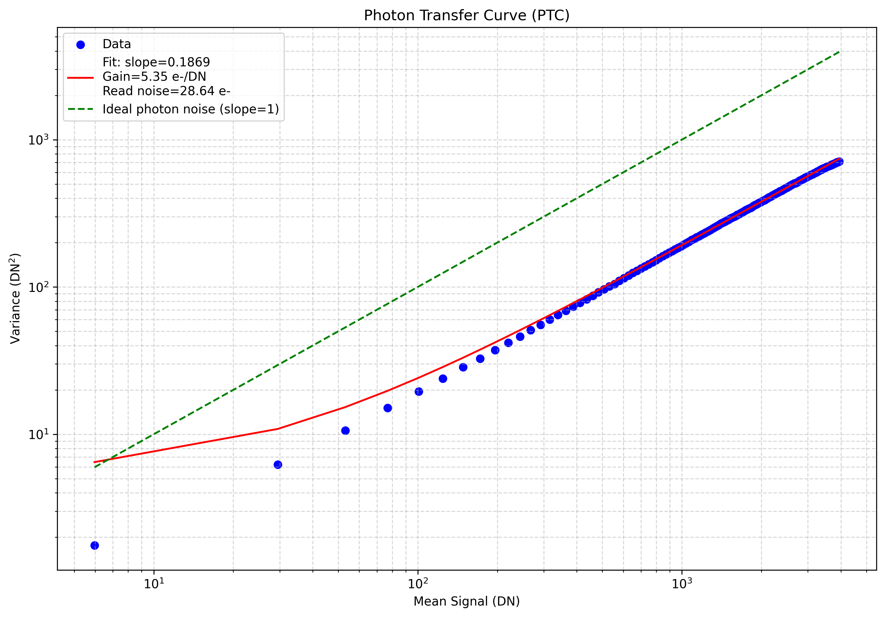
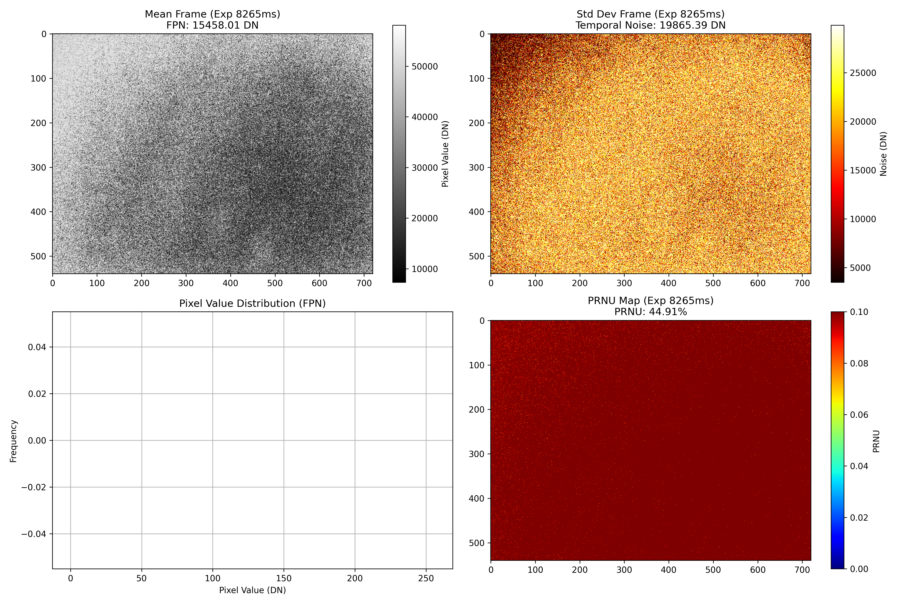
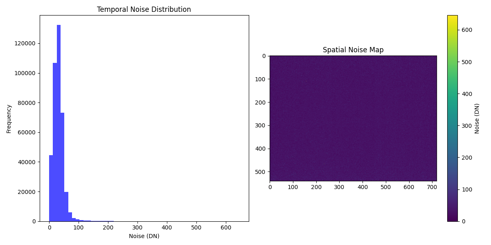
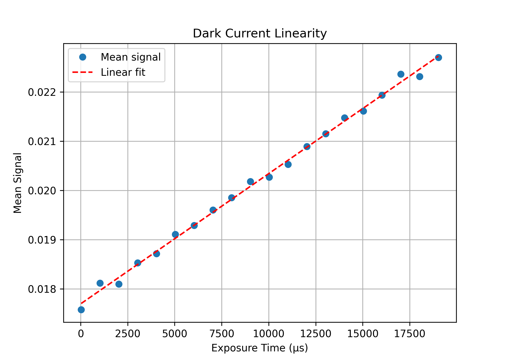
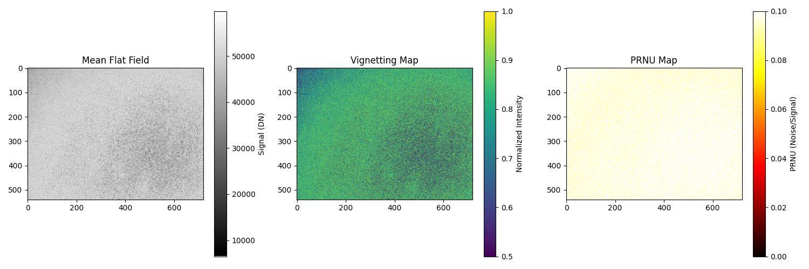
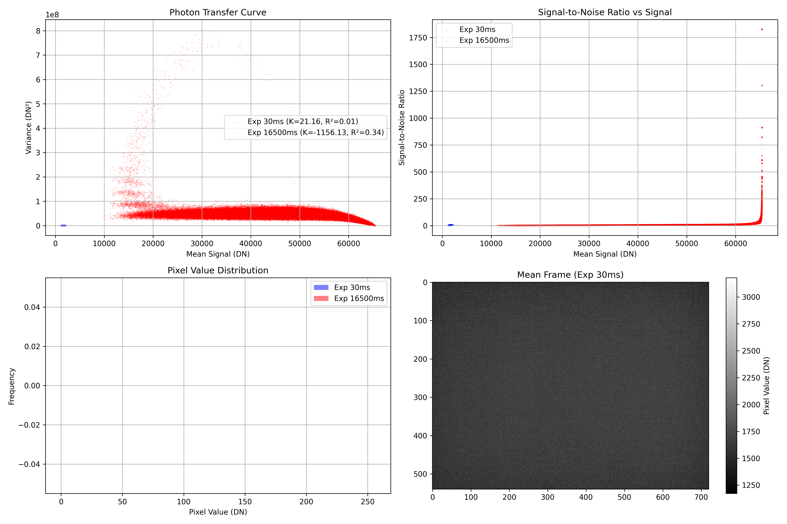
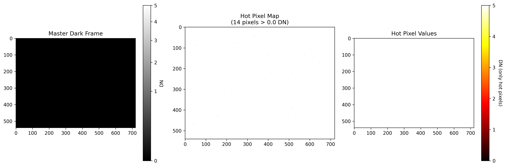
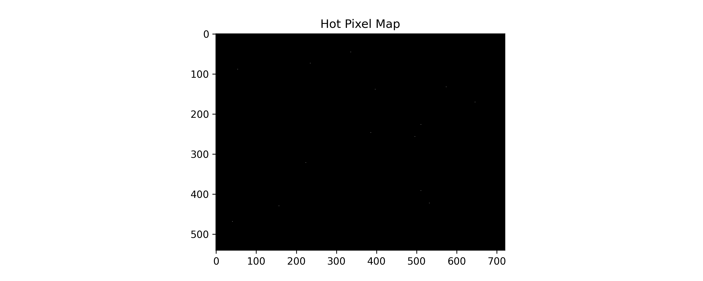
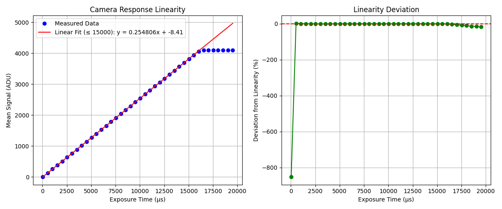

<div align="center">
  

  <p><strong>Optical hardware development · Camera sensor testing · Python image analysis</strong></p>

  <p>
    
    
    
    
  </p>

  <p><a href="#overview">Overview</a> · <a href="#characterization-workflow">Workflow</a> · <a href="#results-gallery">Results</a> · <a href="#repository-structure">Repository</a></p>
</div>

---

## Overview

This repository documents a camera-sensor characterization project built around an integrating-sphere setup. The work combines optical test hardware with Python-based analysis of camera image datasets to examine sensor response, noise, uniformity and image-quality characteristics.

The analysis scripts and result files are organized by characterization task. The repository includes FITS image data, Python analysis scripts, plots and exported numerical summaries.

## Characterization workflow

| Area | What is examined | Available project material |
|---|---|---|
| Photon Transfer Curve (PTC) | Signal–variance behaviour and sensor response | `PTC.py`, PTC plots |
| Bias and dark frames | Baseline signal and dark-frame behaviour | `bias.py`, `dark.py`, dark-analysis outputs |
| Dark current | Signal variation with exposure | `dark_current.py`, summary and plots |
| Fixed-pattern noise (FPN) | Spatial noise structure across frames | `FPN.py`, 100-frame analysis output |
| Flat-field response | PRNU and illumination non-uniformity | `flat_field.py`, flat-field outputs |
| Hot pixels | Pixel-level outliers in dark frames | `hot_pixel.py`, pixel map and CSV |
| Linearity | Response consistency across signal levels | `linearity.py`, results CSV and plot |
| Dynamic range | Usable signal range relative to noise | `dynamic_range.py`, metrics and plots |

## Results gallery

The figures below are generated outputs already included in this repository.

### Photon Transfer Curve



### Fixed-pattern noise



### Dark-frame and dark-current analysis

<p align="center">
  
</p>
<p align="center">
  
</p>

### Flat-field response



### Dynamic range



### Hot-pixel detection

<p align="center">
  
</p>
<p align="center">
  
</p>

### Linearity



## Selected recorded outputs

The following values are copied from the text/JSON summaries currently stored in `results/`. They are presented as recorded outputs, not as independently validated sensor specifications.

| Analysis | Recorded output |
|---|---:|
| FPN analysis | 100 frames; reported PRNU: 44.91% |
| Flat-field analysis | Average signal: 47,770.52 DN |
| Flat-field analysis | Reported average PRNU: 31.42% |
| Flat-field analysis | Reported maximum vignetting: 89.13% |
| Hot-pixel analysis | 14 hot pixels detected in 400 dark frames |

> **Interpretation note:** The repository contains multiple analysis outputs and metric definitions. Values should be interpreted in the context of the corresponding script, dataset, exposure and calculation method. In particular, the two PRNU values above come from different result summaries and should not be treated as interchangeable.

## Tools and data

- **Python** for analysis workflows
- **FITS / TIFF** image datasets
- **NumPy, Matplotlib** and related scientific Python tooling (as used by the analysis scripts)
- **Teledyne FLIR SpinView** for camera acquisition workflow context

## Repository structure

```text
Integrating_sphere/
├── Camera_characterization/
│   ├── FNP/                 # FPN image sequence
│   ├── PTC/                 # PTC figure
│   └── python/              # Characterization scripts
├── results/
│   ├── FPN/
│   ├── PTC/
│   ├── bias/
│   ├── dark/
│   ├── dynamic_range/
│   ├── flat_field_analysis/
│   ├── hot_pixel/
│   └── linearity/
├── assets/                  # Repository presentation assets
└── README.md
```

## About the project

**Author:** Palak Prabhat  
**Institution:** Indian Institute of Technology Kanpur  
**Project area:** Camera sensor performance characterization

---

<div align="center">
  <sub>Built to document experimental work, analysis workflows and sensor-characterization results.</sub>
</div>
